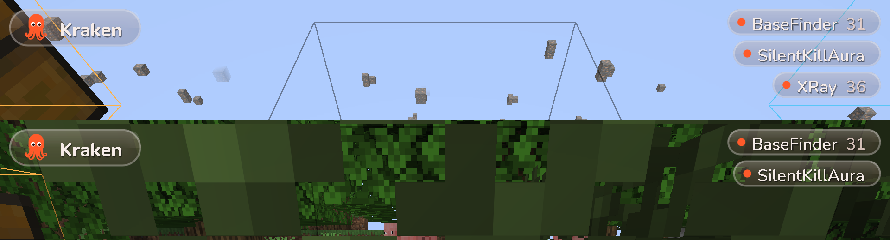
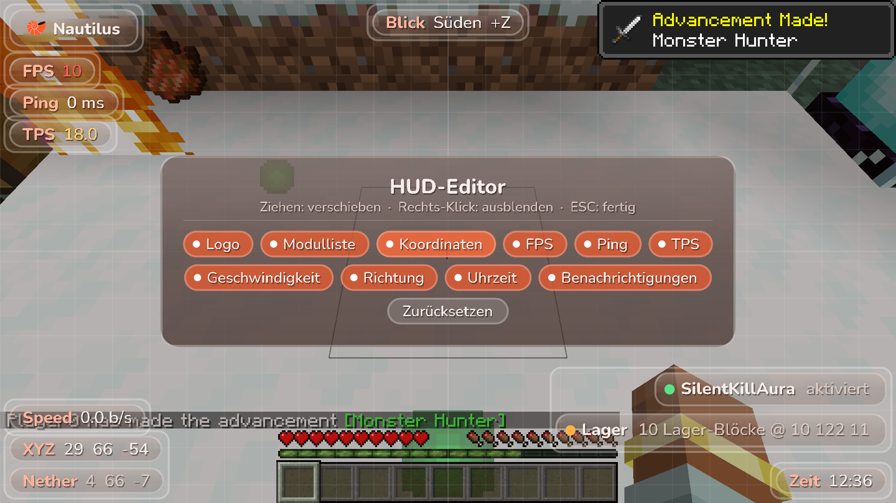

# Kraken

> ⚠️ **Alpha – Kraken ist noch in Entwicklung.** Funktionen können fehlen, sich ändern oder Fehler haben.

Fabric client mod for **Minecraft 26.3** (Java 25, Fabric Loader 0.20+, Fabric API 0.165+) with a radial wheel GUI instead of a click GUI.

| Kategorien | Modul-Rad | Einstellungen |
|---|---|---|
|  |  |  |

| HUD | HUD-Editor |
|---|---|
|  |  |

| BaseFinder (ESP durch Wände) | XRay |
|---|---|
|  |  |

## Download

**Webseite:** https://dizzle-hd.github.io/Kraken/ – lädt automatisch immer den neuesten Build.
Alternativ direkt unter [Releases](https://github.com/dizzle-hd/Kraken/releases/latest).

Jeder Push auf den Standard-Branch baut den Mod per GitHub Actions (`.github/workflows/release.yml`) und
veröffentlicht ihn als neues Release `v<version>-build.<nummer>`. Die Webseite (`site/`, veröffentlicht über
`.github/workflows/pages.yml`) liest das neueste Release über die GitHub-API.

Alle Icons und der Spielerkopf in der Mitte sind echte, sich drehende 3D-Modelle. Die Schrift ist
[Nunito](https://github.com/googlefonts/nunito) (SIL Open Font License, siehe `assets/kraken/font/OFL.txt`).

## Bedienung

| Aktion | Taste |
|---|---|
| Rad öffnen / schließen | `Rechts-Shift` (in den Minecraft-Steuerungen änderbar) |
| Kategorie öffnen | Links-Klick auf ein Segment |
| Modul an/aus | Links-Klick auf ein Modul |
| Einstellungen eines Moduls | Rechts-Klick auf ein Modul – die Einstellungen erscheinen direkt im Rad |
| Schalter / Modus ändern | Klick auf das Segment (Rechts-Klick = Modus rückwärts) |
| Zahlenwert | Am orangen Bogen ziehen oder über dem Segment scrollen |
| Mehr Einstellungen | Scrollen außerhalb eines Zahlen-Segments blättert die Seite um |
| Zurück | Klick auf die Mitte oder `ESC` |
| Modul-Taste setzen | In den Einstellungen auf „Taste“ klicken, Taste drücken (`Backspace` = entfernen) |

Alles wird in `config/kraken.json` gespeichert.

## Module

### Combat
- **TriggerBot** – schlägt zu, sobald dein Fadenkreuz auf einem Ziel liegt (Abklingzeit, Zufallsverzögerung, Nur-Krits).
- **SilentAim** – Klicks, die danebengehen würden, werden auf das nächste Ziel im FOV-Kegel umgeleitet. Die Rotation geht nur an den Server.
- **SilentKillAura** – ein Ziel, wartet auf volle Abklingzeit, weiche stille Server-Rotation, Sichtlinie nötig.
- **BlatantKillAura** – große Reichweite, mehrere Ziele, durch Wände, CPS-Modus, Kamera rastet ein (oder Silent).

### SMP
- **XRay** – blendet alles außer ausgewählten Erzen/Kisten aus, optional Fullbright. *(Nicht kompatibel mit Sodium.)*
- **BaseFinder** – jeder Hinweis einzeln schaltbar:
  - **Amethyst-Grower**: Geoden mit hohem Anteil ausgewachsener Cluster → Chunk war lange geladen.
  - **Sound-Blöcke**: Positionen, an denen der Server Geräusche abspielt (Kolben, Türen, Truhen, Öfen, Amboss, Werfer …), optional auch Abbau-/Platzier-Geräusche.
  - **Lager**: Chunks mit vielen Truhen/Fässern/Öfen/Trichtern, jede Shulker-/Endertruhe.
  - **Spieler-Blöcke**: Leuchtfeuer, Zaubertisch, Amboss, Schilder, Beobachter, Komparatoren …
  - **Portale**: aktivierte Netherportale in Oberwelt/End.
  - **Kelp-Wachstum**: Kelp, das bis zur Oberfläche gewachsen ist.
  - **Objekte**: Rahmen, Rüstungsständer, benannte/gezähmte Tiere, Kistenloren.
  - Chat-Meldungen und Tracer.

### Client
- **HUD-Editor** – Klick im Rad öffnet den Editor: Elemente ziehen (rasten an Rändern, Mitte und anderen Elementen ein), Rechts-Klick blendet aus, Chips im Panel blenden ein/aus, „Zurücksetzen“ stellt das Standard-Layout her.
- **HUD-Elemente** – Logo, Modulliste, Koordinaten (inkl. Nether/Oberwelt), FPS, Ping, TPS, Geschwindigkeit, Richtung, Uhrzeit, Benachrichtigungen.
- **Benachrichtigungen** – Modul an/aus und BaseFinder-Funde erscheinen als Glas-Toasts im HUD statt im Chat.
- **HUD** – Kraken-Logo (animierte Krake) + Liste aktiver Module als transparente, abgerundete Glas-Pillen im Stil des Rads (gleiten beim An-/Ausschalten herein/heraus).
- **Notifications** – Chat-Meldung beim An-/Ausschalten.

## Bauen

```
./gradlew build
```
Benötigt **JDK 25**. Die Mod liegt danach in `build/libs/kraken-2.0.0.jar` (benötigt Fabric Loader + Fabric API für 26.3).

Minecraft 26.x ist nicht mehr obfuskiert – der Code nutzt direkt die offiziellen Mojang-Namen, ohne Yarn-Mappings.

## Automatischer Ingame-Test

```
./gradlew runClientGameTest
```
Startet Minecraft, erstellt eine Welt, öffnet das Rad, schaltet Module, baut eine Test-„Basis“ für den
BaseFinder, prüft XRay und lässt die SilentKillAura einen Zombie besiegen (Kamera darf sich dabei nicht drehen).
Screenshots landen in `build/run/clientGameTest/screenshots`.

## Neues Modul hinzufügen

1. Klasse in `dev.kraken.module.<kategorie>` von `Module` ableiten.
2. Settings mit `add(new BoolSetting(...))` usw. anlegen.
3. In `ModuleManager.init()` registrieren. Neue Kategorien in `Category` eintragen – das Rad passt sich automatisch an.
