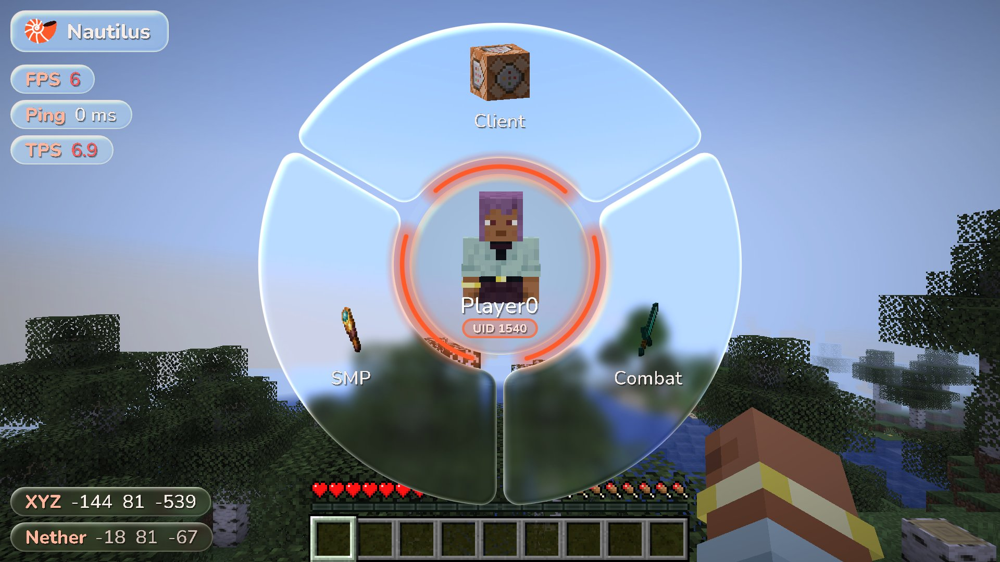
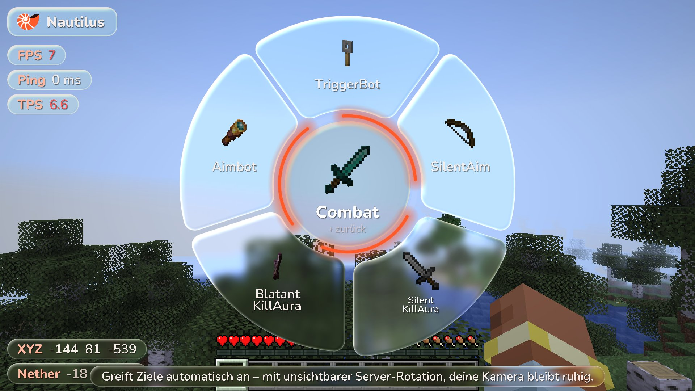
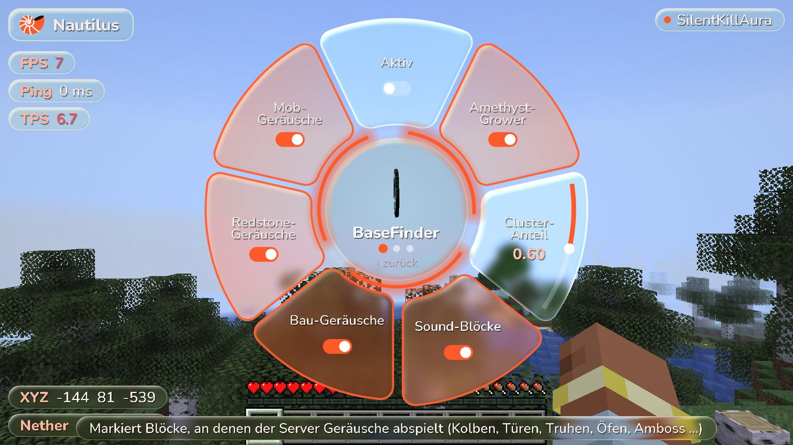
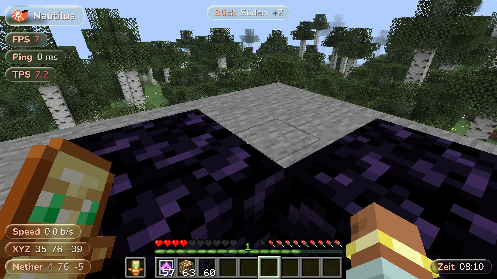
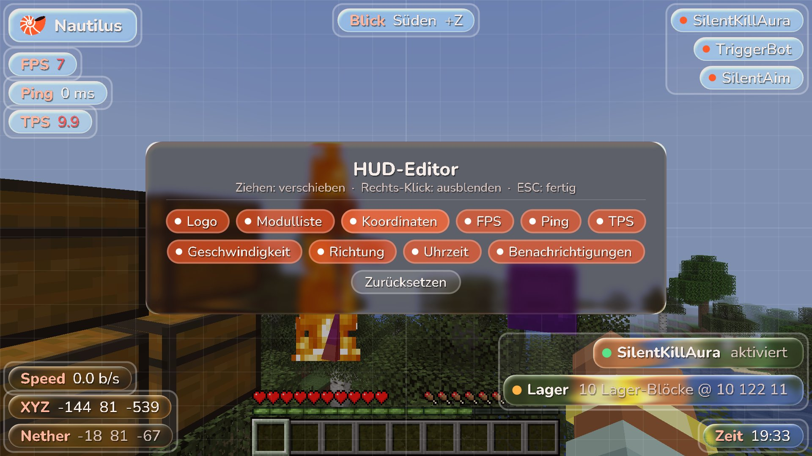
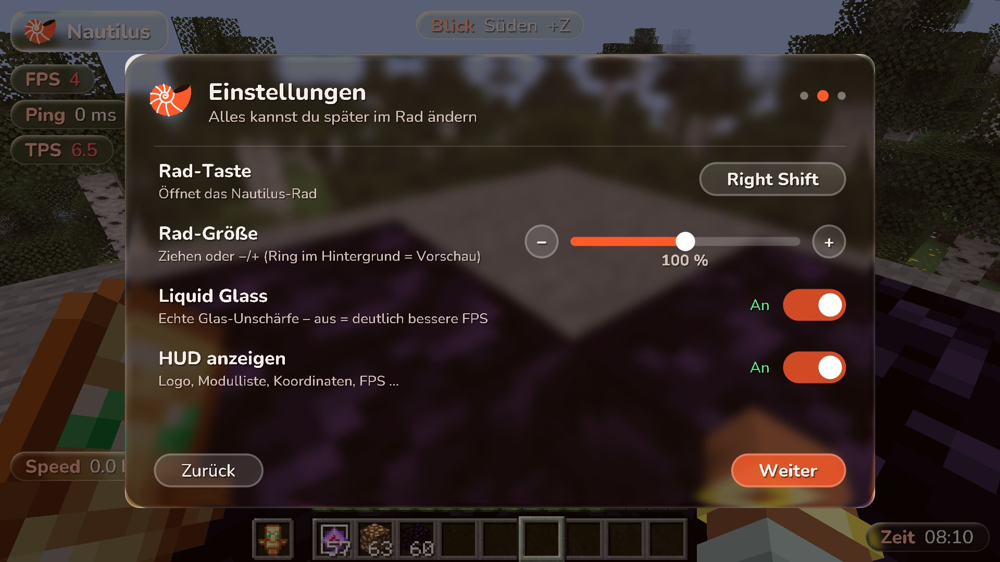
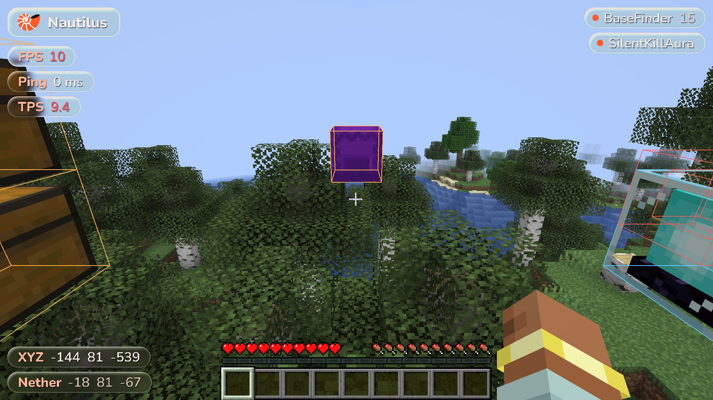
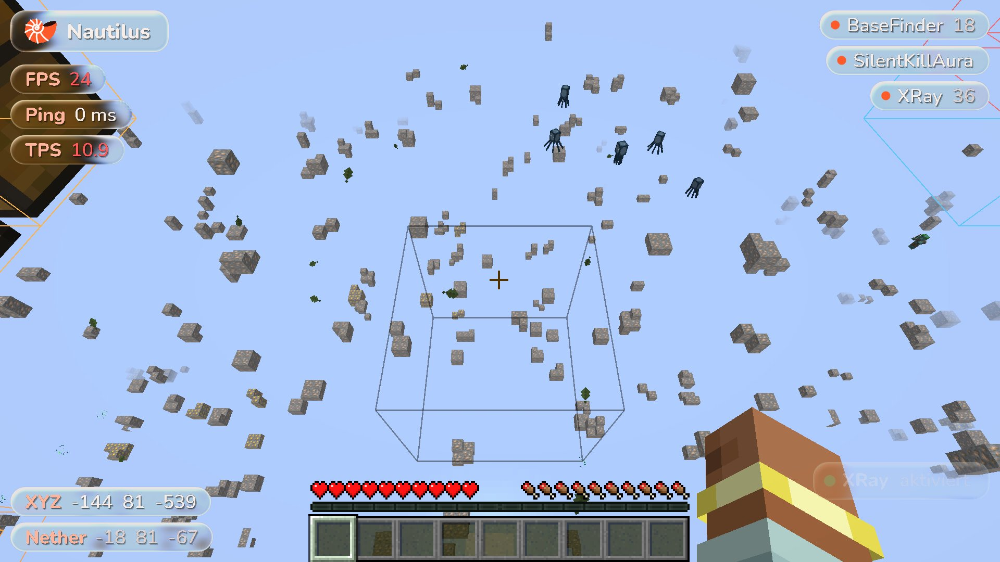

# Nautilus Client

> ⚠️ **Alpha – Nautilus Client ist noch in Entwicklung.** Funktionen können fehlen, sich ändern oder Fehler haben.
>
> ⚠️ **Sodium:** Nautilus Client startet auch mit Sodium, XRay schaltet sich dann aber automatisch ab. Alles andere ist mit Sodium (und Iris) experimentell.

Fabric client mod for **Minecraft 26.3** (Java 25, Fabric Loader 0.20+, Fabric API 0.165+) with a radial wheel GUI instead of a click GUI.

| Rad | Combat | Einstellungen |
|---|---|---|
|  |  |  |

| HUD | HUD-Editor | Einrichtung |
|---|---|---|
|  |  |  |

| BaseFinder (ESP durch Wände) | XRay |
|---|---|
|  |  |

## Download

**Webseite:** https://dizzle-hd.github.io/Kraken/ – lädt automatisch immer den neuesten Build.
Alternativ direkt unter [Releases](https://github.com/dizzle-hd/Kraken/releases/latest).

Jeder Push auf den Standard-Branch baut den Mod per GitHub Actions (`.github/workflows/release.yml`) und
veröffentlicht ihn als neues Release `v<version>-build.<nummer>`. Die Webseite (`site/`, veröffentlicht über
`.github/workflows/pages.yml`) liest das neueste Release über die GitHub-API.

Unter **Modules** auf der Webseite lässt sich jedes Modul anklicken: Was es macht, die Presets mit Bann-Ampel und
alle Einstellungen mit Standardwert und Bereich. Die Daten (`site/modules.json`) erzeugt `tools/gen_modules.py`
direkt aus dem Java-Code; der Webseiten-Workflow ruft das Skript vor jedem Deploy auf.

Rad, Mitte und HUD sind aus **Liquid Glass** (eigener Shader: Unschärfe nur hinter dem Glas, Lichtbrechung am Rand, Lichtkante; im HUD-Modul abschaltbar). Alle Icons sind echte, sich drehende 3D-Modelle, in der Mitte steht der Spieler als 3D-Büste und schaut zur Maus. Die Schrift ist
[Nunito](https://github.com/googlefonts/nunito) (SIL Open Font License, siehe `assets/nautilusclient/font/nunito_ofl_license.txt`).

## Einrichtung

Beim ersten Betreten einer Welt öffnet sich die **Einrichtung**: Hinweise (Alpha, experimentelle Module, Sodium/Iris gefunden, Server-Regeln), dann Rad-Taste, Rad-Größe (mit Vorschau), Liquid Glass, HUD an/aus und HUD-Farbe, zum Schluss die wichtigsten Tasten. Erneut öffnen: im Rad unter **Client → Einrichtung**.

## Bedienung

| Aktion | Taste |
|---|---|
| Rad öffnen / schließen | `Rechts-Shift` (in den Minecraft-Steuerungen änderbar) |
| Kategorie öffnen | Links-Klick auf ein Segment |
| Modul an/aus | Links-Klick auf ein Modul |
| Einstellungen eines Moduls | Rechts-Klick auf ein Modul – das Rad gleitet nach links, rechts öffnet sich ein Einstellungs-Panel |
| Schalter / Modus ändern | Klick auf das Segment (Rechts-Klick = Modus rückwärts) |
| Zahlenwert | Am orangen Bogen ziehen oder über dem Segment scrollen |
| Mehr Einstellungen | Scrollen außerhalb eines Zahlen-Segments blättert die Seite um |
| Zurück | Klick auf die Mitte oder `ESC` |
| Modul-Taste setzen | In den Einstellungen auf „Taste“ klicken, Taste drücken (`Backspace` = entfernen) |

Alles wird in `config/nautilusclient.json` gespeichert (eine alte `config/kraken.json` wird beim ersten Start automatisch übernommen).

## Presets

Combat-, Crystal- und Mace-Module haben im Einstellungs-Panel **oben eine Preset-Leiste** (z. B. Legit / Normal / Rage) mit einer Ampel für das geschätzte Bann-Risiko: 🟢 niedrig · 🟡 mittel · 🔴 hoch. Klick lädt das Preset, das aktive ist markiert. Die Ampel ist eine grobe Einschätzung (Tempo, Regelmäßigkeit, Reichweite) – keine Garantie gegen Anti-Cheats.

## Module

### Combat
- **TriggerBot** – schlägt zu, sobald dein Fadenkreuz auf einem Ziel liegt (Abklingzeit, Zufallsverzögerung, Nur-Krits).
- **SilentAim** – Klicks, die danebengehen würden, werden auf das nächste Ziel im FOV-Kegel umgeleitet. Die Rotation geht nur an den Server.
- **SilentKillAura** – ein Ziel, wartet auf volle Abklingzeit, weiche stille Server-Rotation, Sichtlinie nötig; schlägt erst, wenn die Server-Rotation die Hitbox wirklich trifft (oder innerhalb der Toleranz liegt).
- Alle Auren und der Aimbot teilen sich: **Zielpunkt** (Auto/Kopf/Brust/Beine), **Vorhersage** (Ticks) und **Ziel halten**. Ziele hinter Wänden werden über mehrere sichtbare Hitbox-Punkte erkannt und angezielt.
- **Aimbot** – zieht dein Fadenkreuz weich (pro Frame, Ease-Out + Max. Drehung) auf das beste Ziel im FOV. Zielt auf den Punkt mit der kleinsten Drehung (wählbar Kopf/Brust/Beine), hält bewegte Ziele vor (Vorhersage), bleibt beim aktuellen Ziel (Ziel-Lock), optional nur beim Klicken oder nur horizontal.
- **BlatantKillAura** – große Reichweite, mehrere Ziele, durch Wände, CPS-Modus, Kamera rastet ein (oder Silent).

### Crystal
- **AutoCrystal** – platziert End-Kristalle auf Obsidian/Bedrock dort, wo sie dem Ziel am meisten schaden, und zerstört sie – auf Wunsch im selben Moment, in dem sie erscheinen (Kristall-Spam). Schaden wird wie in Vanilla berechnet (Abstand, Deckung, Rüstung, Schutz-Verzauberungen, Resistenz). Einstellbar: Ziele, Reichweiten, Verzögerungen, Kristalle pro Tick, Min. Schaden, Max. Eigenschaden, Anti-Selbstmord, Face-Place, Auto-Wechsel, Silent-Rotation, Nur eigene Kristalle, Anzeige.
- **AnchorMacro** – lädt den anvisierten Respawn-Anker mit Glowstone und sprengt ihn mit einem anderen Item (Auslöser: neue Anker / immer / Makro-Taste; Ladungen, Verzögerung + Zufall, Spreng-Item, Max. Eigenschaden, Anti-Selbstmord, Zurückwechseln). Im Nether aus (dort setzen Anker den Spawn).
- **SafeAnchor** – setzt vor der Explosion einen Schutzblock zwischen dich und den Anker (Glowstone/Obsidian/beliebig, zu dir oder zusätzlich oben). Alleine nutzbar oder kombiniert mit AnchorMacro.
- **AutoTotem** – hält ein Totem in der Zweithand (immer oder unter einer Leben-Grenze, darüber Kristall/Goldapfel).
- **Surround** – umgibt deine Füße mit Obsidian (Zentrieren, Stützblöcke, doppelte Höhe, aus beim Weggehen).
- **PopCounter** – zählt die Totem-Pops anderer Spieler (Glas-Toast pro Pop) und meldet, nach wie vielen Pops jemand stirbt; die Zahl steht auch im Ziel-HUD. Liest nur, was der Server schickt – sendet nichts.

### Spear
- **SpearSwitch** – Lunge im Dauerfeuer: du hältst einen leeren (oder anderen) Slot, pro Stoß wird im selben Tick kurz auf den Speer gewechselt, zugestochen und zurückgewechselt – so zählt nur der kurze Cooldown der leeren Hand. Auslöser: an/aus per Modul-Taste, Halten einer eigenen Lunge-Taste oder solange die Angriffstaste gedrückt ist. Intervall, Zufall, Park-Slot, nur Speere mit Lunge, Hunger-Schutz. Lunge wirkt nur zu Fuß (nicht reitend, nicht mit Elytra, nicht im Wasser) und ab 7 Hunger.

### Mace
- **MaceSwap** – du behältst Schwert (oder etwas anderes) in der Hand: sobald du beim Fallen zuschlägst (Smash ab 1,5 Blöcken), geht der Schlag im selben Tick mit dem Streitkolben raus, danach bist du wieder auf deinem Slot. Gilt für eigene Klicks und alle Combat-Module. Bei mehreren Streitkolben wird der beste fürs Ziel gewählt (Dichte bei hohem Fall, Bresche gegen Rüstung) oder der bevorzugte (Dichte/Bresche/Windstoß). Min. Fallhöhe, auch ohne Fall, nur Spieler, Zurückwechseln.
- **AutoSmash** – schlägt beim Fallen auf ein Ziel automatisch zu, ein Smash pro Fall. Timing „Spät“ wartet auf den letzten Tick vor dem Aufprall bzw. bevor das Ziel aus der Reichweite fällt (Smash-Schaden wächst mit jedem Block). Zielen per Fadenkreuz oder Silent, Reichweite, Min. Fallhöhe, nur mit Streitkolben (in der Hand oder über MaceSwap).
- **StunSlam** – blockt das Ziel mit einem Schild, kommt im selben Tick zuerst ein Axt-Schlag (Schild 5 s aus), dann dein eigentlicher Schlag – mit MaceSwap der Streitkolben-Smash. Optional nur beim Fallen und nur, wenn der Schild zu dir zeigt.
- **WindBoost** – springt und wirft im selben Tick eine Windkugel senkrecht nach unten (nur für den Server, die Kamera bleibt) und katapultiert dich für einen Smash hoch. Auslöser „Einmal“ (Modul-Taste = ein Boost) oder „Taste“ (eigene Boost-Taste), Zweithand wird zuerst genutzt.

### Player
- **AutoSprint** – hält beim Vorwärtslaufen automatisch die Sprint-Taste.
- **AutoEat** – isst automatisch, wenn der Hunger unter die Grenze fällt (Lunge kostet viel Hunger), optional mit Goldäpfeln, nicht während du angreifst.

### SMP
- **XRay** – blendet alles außer ausgewählten Erzen/Kisten aus, optional Fullbright. *(Funktioniert nicht mit Sodium – schaltet sich dort automatisch ab.)*
- **BaseFinder** – jeder Hinweis einzeln schaltbar:
  - **Amethyst-Grower**: Geoden mit hohem Anteil ausgewachsener Cluster → Chunk war lange geladen.
  - **Sound-Blöcke**: markiert durch Wände die Blöcke, an denen der Server Geräusche abspielt (Kolben, Türen, Truhen, Öfen, Amboss, Werfer …). Einzeln schaltbar: Bau-Geräusche, Redstone-Geräusche (Komparatoren, Fackeln, Stolperdraht, Sculk …), Mob-Geräusche und Schritte (z. B. ein Dorfbewohner, der herumläuft oder redet → der Block, auf dem er steht, leuchtet orange) sowie „Alle Geräusche“.
  - **Lager**: Chunks mit vielen Truhen/Fässern/Öfen/Trichtern, jede Shulker-/Endertruhe.
  - **Spieler-Blöcke**: Leuchtfeuer, Zaubertisch, Amboss, Schilder, Beobachter, Komparatoren …
  - **Portale**: aktivierte Netherportale in Oberwelt/End.
  - **Kelp-Wachstum**: Kelp, das bis zur Oberfläche gewachsen ist.
  - **Objekte**: Rahmen, Rüstungsständer, benannte/gezähmte Tiere, Kistenloren.
  - Chat-Meldungen und Tracer.

### Client
- **HUD-Editor** – Klick im Rad öffnet den Editor: Elemente ziehen (rasten an Rändern, Mitte und anderen Elementen ein), Rechts-Klick blendet aus, Chips im Panel blenden ein/aus, „Zurücksetzen“ stellt das Standard-Layout her.
- **HUD-Elemente** – Logo, Modulliste, Koordinaten (inkl. Nether/Oberwelt), FPS, Ping, TPS, Geschwindigkeit, Richtung, Uhrzeit, Benachrichtigungen, dazu:
  - **Ziel** – Name, Distanz, Lebensbalken (Absorption in Gold), Rüstung und Totem-Pops deines Ziels (Fadenkreuz oder zuletzt geschlagen).
  - **Smash-Vorschau** – beim Fallen mit Streitkolben in der Hotbar: Fallhöhe und der Schaden, den ein Smash jetzt machen würde (aufs Ziel nach Rüstung).
  - **Rüstung** – Haltbarkeit von Kopf, Brust, Hose, Schuhen und Waffe in Prozent (im HUD-Editor einschalten).
- **HUD-Farbe** – Orange, Rot, Pink, Lila, Blau, Türkis, Grün, Gold, Weiß oder Regenbogen: färbt Logo, Modulliste, Beschriftungen, Glas-Tönung und Editor. Einstellbar in der Einrichtung (mit Live-Vorschau) und im Rad unter Client → HUD.
- **Benachrichtigungen** – Modul an/aus und BaseFinder-Funde erscheinen als Glas-Toasts im HUD statt im Chat.
- **HUD** – Nautilus-Logo (sanft schaukelnde Nautilus-Muschel) + Liste aktiver Module als transparente, abgerundete Glas-Pillen im Stil des Rads (gleiten beim An-/Ausschalten herein/heraus).
- **Notifications** – Chat-Meldung beim An-/Ausschalten.
- **Zoom** – zoomt auf eigener Taste heran (Standard `C`, im Rad unter „Zoom-Taste“ änderbar). Modus Halten/Umschalten, Stärke 1,5–50×, Mausrad zoomt beim Zoomen weiter, weiches Ein-/Auszoomen, langsamere Maus.
- **Freecam** – Kamera löst sich vom Spieler und fliegt frei (WASD, Leertaste, Shift, Sprint = schneller), auch durch Blöcke. Dein Spieler bleibt stehen und ist sichtbar; Tempo einstellbar.

## Bauen

```
./gradlew build
```
Benötigt **JDK 25**. Die Mod liegt danach in `build/libs/nautilus-client-2.1.0.jar` (benötigt Fabric Loader + Fabric API für 26.3).

Minecraft 26.x ist nicht mehr obfuskiert – der Code nutzt direkt die offiziellen Mojang-Namen, ohne Yarn-Mappings.

## Automatischer Ingame-Test

```
./gradlew runClientGameTest
```
Startet Minecraft, erstellt eine Welt, öffnet das Rad, schaltet Module, baut eine Test-„Basis“ für den
BaseFinder, prüft XRay und lässt die SilentKillAura einen Zombie besiegen (Kamera darf sich dabei nicht drehen).
Screenshots landen in `build/run/clientGameTest/screenshots`.

## Neues Modul hinzufügen

1. Klasse in `dev.nautilus.module.<kategorie>` von `Module` ableiten.
2. Settings mit `add(new BoolSetting(...))` usw. anlegen.
3. In `ModuleManager.init()` registrieren. Neue Kategorien in `Category` eintragen – das Rad passt sich automatisch an.

---

© 2026 Nautilus Client. Alle Rechte vorbehalten. Der Name „Nautilus Client“ und das Nautilus-Logo gehören zum Nautilus-Client-Projekt.
Nautilus Client ist ein unabhängiges Fan-Projekt und steht in keiner Verbindung zu Mojang oder Microsoft. Minecraft ist eine Marke von Mojang AB.
