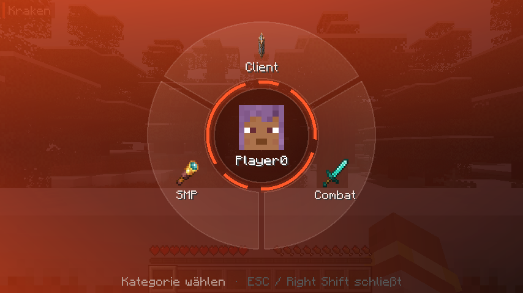
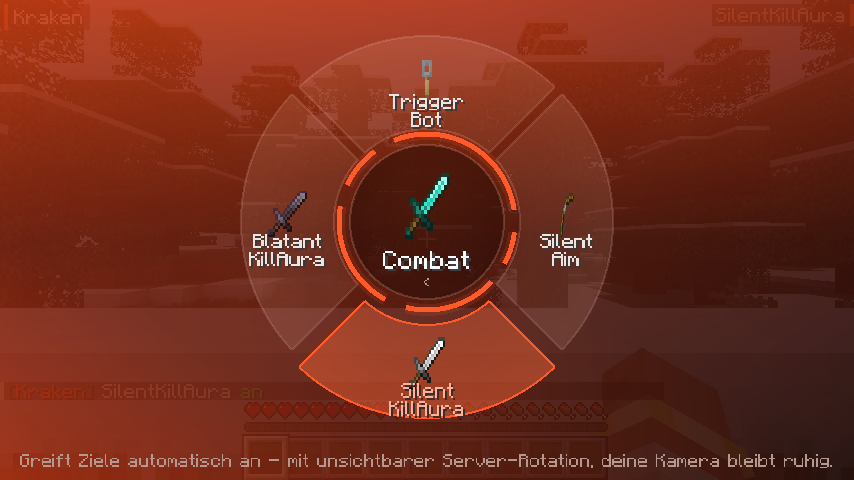
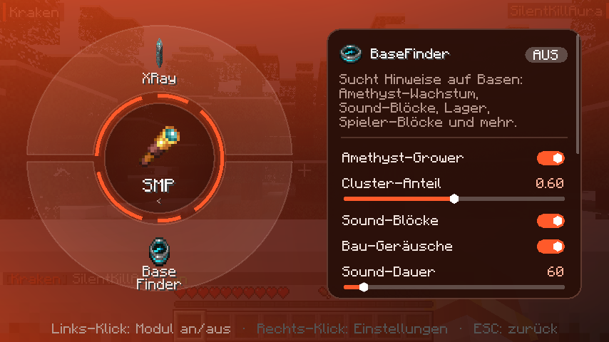
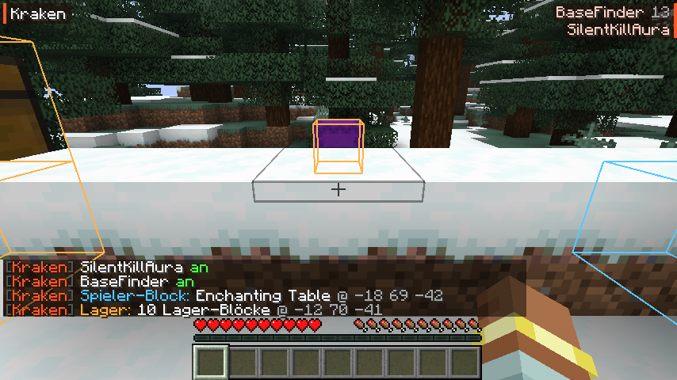
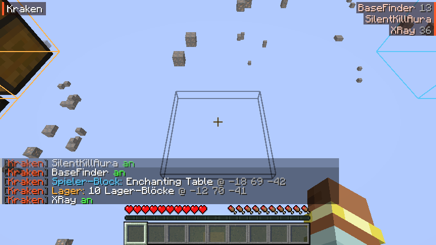

# Kraken

Fabric client mod for **Minecraft 1.21.11** with a radial wheel GUI instead of a click GUI.

| Kategorien | Modul-Rad | Einstellungen |
|---|---|---|
|  |  |  |

| BaseFinder (ESP durch Wände) | XRay |
|---|---|
|  |  |

## Bedienung

| Aktion | Taste |
|---|---|
| Rad öffnen / schließen | `Rechts-Shift` (in den Minecraft-Steuerungen änderbar) |
| Kategorie öffnen | Links-Klick auf ein Segment |
| Modul an/aus | Links-Klick auf ein Modul |
| Einstellungen eines Moduls | Rechts-Klick auf ein Modul |
| Zurück | Klick auf die Mitte oder `ESC` |
| Modul-Taste setzen | Im Einstellungs-Panel auf „Taste“ klicken, Taste drücken (`Backspace` = entfernen) |

Alles wird in `config/kraken.json` gespeichert.

## Module

### Combat
- **TriggerBot** – schlägt zu, sobald dein Fadenkreuz auf einem Ziel liegt (Abklingzeit, Zufallsverzögerung, Nur-Krits).
- **SilentAim** – Klicks, die danebengehen würden, werden auf das nächste Ziel im FOV-Kegel umgeleitet. Die Rotation geht nur an den Server.
- **SilentKillAura** – ein Ziel, wartet auf volle Abklingzeit, weiche stille Server-Rotation, Sichtlinie nötig.
- **BlatantKillAura** – große Reichweite, mehrere Ziele, durch Wände, CPS-Modus, Kamera rastet ein (oder Silent).

### SMP
- **XRay** – blendet alles außer ausgewählten Erzen/Kisten aus, optional Fullbright. *(Nicht kompatibel mit Sodium.)*
- **BaseFinder** – jeder Hinweis einzeln schaltbar:
  - **Amethyst-Grower**: Geoden mit hohem Anteil ausgewachsener Cluster → Chunk war lange geladen.
  - **Sound-Blöcke**: Positionen, an denen der Server Geräusche abspielt (Kolben, Türen, Truhen, Öfen, Amboss, Werfer …), optional auch Abbau-/Platzier-Geräusche.
  - **Lager**: Chunks mit vielen Truhen/Fässern/Öfen/Trichtern, jede Shulker-/Endertruhe.
  - **Spieler-Blöcke**: Leuchtfeuer, Zaubertisch, Amboss, Schilder, Beobachter, Komparatoren …
  - **Portale**: aktivierte Netherportale in Oberwelt/End.
  - **Kelp-Wachstum**: Kelp, das bis zur Oberfläche gewachsen ist.
  - **Objekte**: Rahmen, Rüstungsständer, benannte/gezähmte Tiere, Kistenloren.
  - Chat-Meldungen und Tracer.

### Client
- **HUD** – Wasserzeichen + Liste aktiver Module.
- **Notifications** – Chat-Meldung beim An-/Ausschalten.

## Bauen

```
./gradlew build
```
Die Mod liegt danach in `build/libs/kraken-1.0.0.jar` (benötigt Fabric Loader + Fabric API).

## Automatischer Ingame-Test

```
./gradlew runClientGameTest
```
Startet Minecraft, erstellt eine Welt, öffnet das Rad, schaltet Module, baut eine Test-„Basis“ für den
BaseFinder, prüft XRay und lässt die SilentKillAura einen Zombie besiegen (Kamera darf sich dabei nicht drehen).
Screenshots landen in `build/run/clientGameTest/screenshots`.

## Neues Modul hinzufügen

1. Klasse in `dev.kraken.module.<kategorie>` von `Module` ableiten.
2. Settings mit `add(new BoolSetting(...))` usw. anlegen.
3. In `ModuleManager.init()` registrieren. Neue Kategorien in `Category` eintragen – das Rad passt sich automatisch an.
